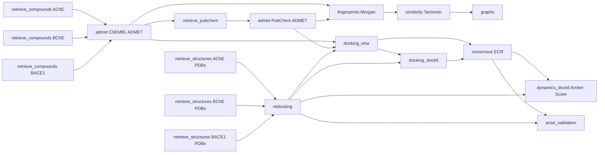

# Modelo de dependências (PHASE-00)

Derivado do código, sem inferência manual: `artifact_contracts.OUTPUT_PORTS`,
`INPUT_PORTS` e `TYPES` (commit `2b3d910`) e o pipeline persistido do projeto
Alzheimer (`projects.pipeline`, lido em modo somente leitura).

## 1. Grafo de contratos (tipos de artefato)

Uma aresta `produtor.porta → consumidor.porta` existe quando os dois lados
compartilham ao menos um tipo de artefato. A entidade de cada tipo está em
`TYPES[...].entity_kind`.

| Tipo | Entidade | Produzido por (porta) | Consumido por (porta) |
| --- | --- | --- | --- |
| `compounds`, `chembl` | compound | todas as recuperações, `admet.filtered_compounds`, `fingerprints.compounds`, `graphs.selected_compounds`, `prepare_structures.compounds`, `docking_*.compounds`, `consensus.consensus_scores` | `retrieve_pubchem`, `expand_similar_compounds` (`chembl`), `admet`, `fingerprints`, `prepare_structures.base_selected_mols`, `docking_vina/dock6.base_selected_mols`, `dynamics_dock6.base_selected_mols` |
| `fingerprints` | compound | `fingerprints.fingerprints` | `similarity.base_input_path` |
| `similarity` | molecular_pair | `similarity.similarity` | `graphs.similarity_path` |
| `structures` | structure | `retrieve_structures`, `redocking.structures` | `prepare_structures`, `redocking`, `docking_vina`, `docking_dock6`, `pose_validation` (`base_input_path`) |
| `prepared_structures` | receptor | `prepare_structures.prepared_receptors`, `redocking.structures` | `prepare_structures`, `redocking`, `docking_vina`, `docking_dock6`, `pose_validation` |
| `receptor_pdb` | receptor | `retrieve_structures`, `prepare_structures`, `redocking`, `docking_*.receptors`, `dynamics_dock6.receptors`, `pose_validation.receptors` | `dynamics_dock6.base_input_path`, `pose_validation.base_input_path` |
| `molecular_poses`, `vina`, `dock6` | pose | `prepare_structures.poses`, `redocking.redocking_results`, `docking_*.docking_results`, `dynamics_dock6.poses`, `pose_validation.validated_poses` | `docking_*.base_selected_mols`, `consensus.base_vina_path/base_dock6_path`, `dynamics_dock6.base_selected_mols`, `pose_validation.base_selected_mols` |
| `scores` | docking_pair | `consensus.consensus_scores`, `pose_validation.validation_report` | `pose_validation.base_selected_mols` |
| `dynamics` | trajectory | `dynamics_dock6.dynamics` | — (terminal) |
| `zinc_urls` | compound | — (upload) | `retrieve_zinc.base_input_path` |

**Artefato com mais consumidores:** a estrutura e o receptor. Os tipos
`structures`, `prepared_structures` e `receptor_pdb` saem de três produtores e
entram em seis operações. Cada consumidor de docking ainda faz sua própria
preparação específica do motor (por exemplo, PDBQT para o Vina e MOL2/DMS/SPH
para o DOCK6), em caches separados. Esse é o ponto de reuso escolhido para a
PHASE-03.

## 2. Instância real — projeto Alzheimer (18 blocos)

As saídas estruturais do `redocking` são consumidas por quatro blocos:
`docking_vina`, `docking_dock6`, `dynamics_dock6` e `pose_validation`.
`consensus` também lê `docking_vina` por `base_input_path`, além de
`base_vina_path`.

## 3. Arestas que existem hoje apenas como JSON

As dependências efetivas de cada artefato são gravadas em
`artifact_instances.dependencies` (texto JSON) e em `artifact_records[*]`
dentro de `runs.stages`. Não há tabela de operações nem de arestas. Por isso,
"o que depende deste receptor?" exige ler e decodificar os descritores das
execuções (ver F-04 em `README.md`). REQ-CAT-001 e REQ-DEP-001 tratam disso.
